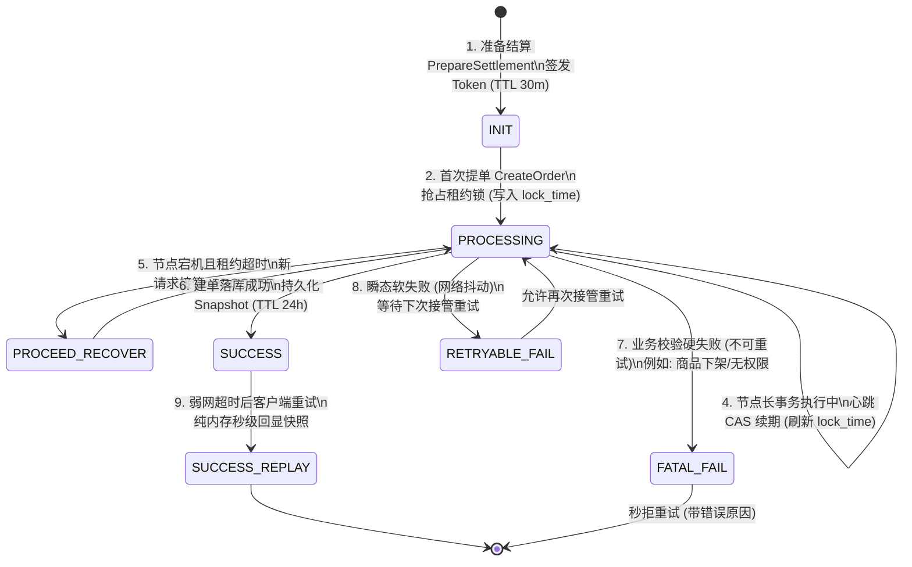

# 电商微服务防重结算令牌 (Settlement Token) 架构设计与实现指南

> **文档说明**：本微服务已彻底移除旧版结算令牌实现代码，将代码库还原为干净的基础订单状态机与主子订单分单拓扑。本文档作为完整的架构技术方案、核心算法详解及从零实现的参考指南，并完整归档了生产级 Lua 脚本、两道防线设计及 Toxiproxy 混沌工程验收测试套件，供自主编码实现时参考。

---

## 一、 业务痛点与技术挑战

在电商交易核心链路中，"提交订单"（Settlement / CreateOrder）是最敏感的写操作。在高并发、弱网与分布式场景下，若无健壮的防重与幂等设计，将引发严重的业务资损与用户体验问题：

```
+---------------------------------------------------------------------------------------+
|                                  典型弱网/连击异常时序                                 |
+---------------------------------------------------------------------------------------+
|  买家移动端                       网关/订单服务                  库存服务/支付渠道      |
|     |                                   |                                |            |
|     |---- [1] 提交订单 (请求 A) ------->|                                |            |
|     |                                   |--- 扣减库存/创建分布式事务 --->|            |
|     |                                   |    (网络高延迟 800ms)          |            |
|     |   * 移动端 300ms 超时取消连接 *   |                                |            |
|     |     (买家看到转圈超时)            |                                |            |
|     |                                   |<-- 库存预占成功 (请求 A 成功) -|            |
|     |                                   |                                |            |
|     |---- [2] 自动重试/买家再次点击 --->|                                |            |
|     |         (请求 B 提单)             |=== 若无防重控制：二次扣库存！ ===|            |
|     |                                   |=== 产生重复两张待支付主单！ ===|            |
|     v                                   v                                v            |
+---------------------------------------------------------------------------------------+
```

### 1. 传统简单防重 (简单 Redis SETNX) 的致命缺陷
1. **死锁风险**：若设置了锁超时（如 `SETNX lock 30s`），业务节点在 DTM Saga 长事务执行中发生 OOM 或网络夯死，锁提前过期；新请求进入重新创建订单，而旧请求恢复后继续提交，导致**双写与库存重复预占**。
2. **提前释放与脑裂**：若业务耗时超过固定锁超时时间，锁自动释放，其他请求重入，导致同一购物车拆出多笔订单。
3. **无结果回显 (Result Replay)**：简单分布式锁在首次提单成功后直接释放。当弱网超时的客户端自动重试时，锁已不复存在，重试请求再次穿透执行，无法**秒级幂等回显首次建单结果**。

---

## 二、 两道防线防御体系 (Two-Tier Defense)

为实现**零资损、零重复建单、秒级幂等回显**，本方案采用"内存状态机 + 数据库物理唯一索引"的两道防线体系：

```
                +-----------------------------------------+
                |        买家结算请求 (携带 Token)        |
                +-----------------------------------------+
                                     |
                                     v
         ================== [第一道防线: Redis Lua] ==================
         |  1. 原子状态机判定 (INIT/PROCESSING/SUCCESS/FAIL)       |
         |  2. 归属人买家 IDOR 强校验 (防越权抢占)                 |
         |  3. 毫秒级拦截连击 (STILL_PROCESSING)                  |
         |  4. 弱网重试秒级回显快照 (SUCCESS_REPLAY，纯内存)      |
         ============================================================
                                     |
                             [放行: PROCEED]
                                     |
                                     v
                        +--------------------------+
                        |   执行分单与 DTM Saga    |
                        |   确定性推导主单号       |
                        +--------------------------+
                                     |
                                     v
         ================== [第二道防线: MySQL 唯一索引] ============
         |  UNIQUE KEY (tenant_id, settlement_token)                |
         |  - 即使 Redis 宕机切主丢数据，或租约接管并发重入         |
         |  - MySQL 数据库底层严格拦截第二次 INSERT                 |
         |  - 事务安全回滚，拦截重复订单落库                        |
         ============================================================
```

### 1. 第一道防线：Redis + Lua 状态机 + 租约心跳续期
- **原子拦截**：提单入口使用 Redis 单一 Hash 结构记录令牌全生命周期状态，通过单段 Lua 脚本原子执行判断与状态迁移。
- **动态租约与心跳续期 (Lease & Heartbeat Renewal)**：抢占成功后赋予短租约（如 5 秒），后台异步 Goroutine 定期以 CAS 方式刷新 `lock_time` 与 TTL。若节点崩溃，续期中断，短租约自然过期自愈，免除死锁；若长事务正常进行，心跳确保锁永不被抢占。
- **纯内存回显 (SUCCESS_REPLAY)**：提单成功后将订单编号及快照写入 Hash。弱网重试请求进入时，Lua 脚本直接返回快照数据，**完全不穿透 MySQL，毫秒级响应**。

### 2. 第二道防线：MySQL 物理唯一索引兜底
- 主订单表 `parent_orders` 建立复合唯一索引：
  ```sql
  UNIQUE KEY uniq_parent_settlement_token (tenant_id, settlement_token)
  ```
- 即使 Redis 遭遇集群切主脑裂丢数据、或租约自愈接管后新旧两节点产生极端竞态，MySQL 在同一商户租户下绝不允许插入相同 `settlement_token` 的第二张主订单。
- 应用层捕获唯一键冲突后，主动反查已存在的主订单，并将其刷新回 Redis 作为终态回显。

---

## 三、 状态机生命周期设计



### 状态字典与迁移规则

| 状态 | 释义 | 迁移条件 | 响应动作 | 建议 TTL |
| :--- | :--- | :--- | :--- | :--- |
| `INIT` | 令牌已签发 | 客户端调用 `PrepareSettlement` 生成 | 允许首次提单抢占 | 30 分钟 |
| `PROCESSING` | 提单处理中 | 首次提单调用 `AcquireSettlementToken` | 锁定租约；并发连击返回 `STILL_PROCESSING` | 租约时长 (默认 5s) |
| `SUCCESS` | 建单终态成功 | 事务提交完毕，调用 `RecordSettlementSuccess` | 幂等回显 `SUCCESS_REPLAY`，直接返回快照 | 24 小时 |
| `FATAL_FAIL` | 业务硬失败 | 商品下架、风控拦截等不可恢复错误 | 返回 `FATAL_FAIL`，秒拒后续重复点击 | 5 分钟 |
| `RETRYABLE_FAIL` | 系统软失败 | RPC 抖动、临时限流等可重试错误 | 允许下一次提单重新接管为 `PROCESSING` | 15 分钟 |

---

## 四、 核心算法与机制设计

### 1. 确定性主订单编号推导算法 (Deterministic OrderNo Derivation)
在分布式微服务架构中，库存预占往往通过 DTM Saga 或本地消息表执行。若每次重试随机生成一个全新订单号（如 `UUID`），重试请求会导致库存预占流水生成全新的行记录，**造成重复预占库存**。

**解决方案**：主订单编号必须由 `tenant_id` 与 `settlement_token` 进行确定性哈希推导：

```go
func DeriveParentOrderNo(tenantID, token string) string {
    // 1. 提取令牌内的毫秒时间戳前缀 (保证时间局部性与 B+ 树写入有序)
    tsPart := time.Now().Format("20060102150405")
    if ms, ok := parseTokenTimestamp(token); ok {
        tsPart = time.UnixMilli(ms).Format("20060102150405")
    }
    
    // 2. 将 (tenant_id + token) 进行 SHA-256 哈希，提取前 8 位 Hex
    h := sha256.New()
    h.Write([]byte(tenantID + ":" + token))
    hashPart := strings.ToUpper(hex.EncodeToString(h.Sum(nil))[:8])
    
    // 3. 输出: PORD + 20261023120000 + ABCDEF12
    return fmt.Sprintf("PORD%s%s", tsPart, hashPart)
}
```

*收益*：同一令牌在任意节点、任意次重试中，推导出的订单号完全一致。下游库存服务在 `inventory_reservations` 表上以 `UNIQUE (tenant_id, order_no, sku_id)` 为约束，即可在底层杜绝重复预占。

### 2. 租约心跳续期机制 (Heartbeat Lease Renewal with CAS)
为防止长耗时提单被判定为超时接管，业务线程在抢占成功后启动后台心跳协程：

```go
func (uc *OrderUsecase) startLeaseRenewal(ctx context.Context, token string, lockTime int64) (cancelFunc func()) {
    ticker := time.NewTicker(uc.leaseTimeout / 3) // 每 1/3 租约窗口续期一次
    stopCh := make(chan struct{})
    
    go func() {
        defer ticker.Stop()
        currentLock := lockTime
        for {
            select {
            case <-stopCh:
                return
            case <-ticker.C:
                // CAS 续期：仅当当前锁时间仍等于 currentLock 时，才更新为新时间戳
                newLock, ok, err := uc.repo.RenewSettlementToken(ctx, token, currentLock, uc.keyTTL)
                if err != nil || !ok {
                    // 续期失败：说明租约已被他人接管或网络断开，立即退出
                    return
                }
                currentLock = newLock
            }
        }
    }()
    
    return func() { close(stopCh) }
}
```

---

## 五、 核心 Redis Lua 脚本规范

### 1. 抢占与状态转移脚本 (`AcquireSettlementToken`)

```lua
-- KEYS[1]: 结算令牌 Redis Key (例如 settlement_token:{token})
-- ARGV[1]: 当前买家用户 ID (user_id, 用于 IDOR 防越权校验)
-- ARGV[2]: 当前系统时间毫秒 (now_ms, 租约起算时间戳)
-- ARGV[3]: 租约有效时长毫秒 (lease_timeout_ms, 如 5000)

local exists = redis.call('EXISTS', KEYS[1])
if exists == 0 then
    return {'EXPIRED', '', '', '', '', ''}
end

-- IDOR 越权校验：严禁跨用户抢占他人令牌
local owner = redis.call('HGET', KEYS[1], 'user_id')
if owner ~= ARGV[1] then
    return {'FORBIDDEN', '', '', '', '', ''}
end

local status = redis.call('HGET', KEYS[1], 'status')

-- 1. 已成功终态：直接回显主单快照，不穿透 MySQL
if status == 'SUCCESS' then
    local pId = redis.call('HGET', KEYS[1], 'parent_order_id') or ''
    local pNo = redis.call('HGET', KEYS[1], 'parent_order_no') or ''
    local snap = redis.call('HGET', KEYS[1], 'order_snapshot') or ''
    return {'SUCCESS_REPLAY', pId, pNo, '', '', snap}
end

-- 2. 硬失败终态：不可重试，直接拦截
if status == 'FATAL_FAIL' then
    local reason = redis.call('HGET', KEYS[1], 'reason') or 'business check failed'
    return {'FATAL_FAIL', '', '', reason, '', ''}
end

-- 3. 初始态或软失败态：首次抢占，推进至 PROCESSING
if status == 'INIT' or status == 'RETRYABLE_FAIL' then
    redis.call('HMSET', KEYS[1], 'status', 'PROCESSING', 'lock_time', ARGV[2])
    redis.call('EXPIRE', KEYS[1], 1800)
    return {'PROCEED', '', '', '', ARGV[2], ''}
end

-- 4. 处理中状态：检查租约是否超时
if status == 'PROCESSING' then
    local lockTime = tonumber(redis.call('HGET', KEYS[1], 'lock_time') or '0')
    local elapsed = tonumber(ARGV[2]) - lockTime
    if elapsed > tonumber(ARGV[3]) then
        -- 租约超时：发生宕机或不可抗力，允许自愈接管
        redis.call('HMSET', KEYS[1], 'status', 'PROCESSING', 'lock_time', ARGV[2])
        redis.call('EXPIRE', KEYS[1], 1800)
        return {'PROCEED', '', '', '', ARGV[2], ''}
    else
        -- 租约窗口期内：拦截并发连击
        return {'STILL_PROCESSING', '', '', '', tostring(lockTime), ''}
    end
end

return {'EXPIRED', '', '', '', '', ''}
```

### 2. CAS 心跳续期脚本 (`RenewSettlementToken`)

```lua
-- KEYS[1]: 结算令牌 Redis Key
-- ARGV[1]: 预期的锁起算时间 (expect_lock_time)
-- ARGV[2]: 新的时间戳 (new_lock_time)
-- ARGV[3]: 整个 Key 的 TTL 秒数 (如 1800)

local status = redis.call('HGET', KEYS[1], 'status')
if status ~= 'PROCESSING' then
    return 0 -- 非 PROCESSING 状态不可续约
end

local currentLock = redis.call('HGET', KEYS[1], 'lock_time')
if currentLock ~= ARGV[1] then
    return 0 -- CAS 失败：锁已被其他人接管，拒绝续期
end

redis.call('HSET', KEYS[1], 'lock_time', ARGV[2])
redis.call('EXPIRE', KEYS[1], tonumber(ARGV[3]))
return 1
```

---

## 六、 从零实现防重结算令牌：手把手步骤指南

当需要在此微服务中重新实现防重令牌功能时，请遵循以下模块化步骤：

### 步骤 1：定义 gRPC 接口与 Proto (`api/proto/order/v1/order.proto`)
1. 在 `OrderService` 声明 `PrepareSettlement` RPC：
   ```protobuf
   rpc PrepareSettlement(PrepareSettlementRequest) returns (PrepareSettlementResponse) {
     option (google.api.http) = {
       post: "/v1/orders/settlement"
       body: "*"
     };
   }
   ```
2. 增加请求与响应消息体：
   ```protobuf
   message PrepareSettlementRequest {
     repeated string sku_ids = 1;
   }
   message PrepareSettlementResponse {
     string settlement_token = 1;
     repeated CartItem items = 2;
     int64 total_amount = 3;
     repeated StoreSettlementGroup store_groups = 4;
     int64 total_discount = 5;
     int64 pay_amount = 6;
   }
   ```
3. 在 `CreateOrderRequest` 中加入 `string settlement_token = 1;` 字段。

### 步骤 2：数据库迁移与模型扩展 (`migrations/` & `internal/data/order.go`)
1. 参照归档 SQL，在 `parent_orders` 增加 `settlement_token` 字段与唯一索引：
   ```sql
   ALTER TABLE parent_orders ADD COLUMN settlement_token VARCHAR(64) NULL AFTER order_no;
   CREATE UNIQUE INDEX uniq_parent_settlement_token ON parent_orders (tenant_id, settlement_token);
   ```
2. 在 `ParentOrderModel` 中增加映射：
   ```go
   SettlementToken *string `gorm:"uniqueIndex:uniq_parent_settlement_token;column:settlement_token;type:varchar(64)" json:"settlement_token"`
   ```

### 步骤 3：数据访问层实现 (`internal/data/`)
1. 在 `MySQLRepository` 中载入上述两个 Lua 脚本，使用 `redisClient.Eval` 执行。
2. 实现 `SaveSettlementToken`、`AcquireSettlementToken`、`RenewSettlementToken`、`RecordSettlementSuccess`、`RecordSettlementFail`。
3. 在 `MemoryRepository` 中实现并发安全的内存模拟版本（使用 `sync.RWMutex` 和 `map[string]*tokenRecord`），以支持单元测试与混沌测试。

### 步骤 4：领域业务逻辑编排 (`internal/biz/`)
1. 在 `OrderRepo` 接口中暴露上述仓储方法。
2. 在 `OrderUsecase.PrepareSettlement` 中：
   - 检查选中购物车条目；
   - 模拟计算店铺分摊金额；
   - 签发令牌 `st-{unixMilli}-{uuid}`；
   - 调用 `repo.SaveSettlementToken` 存储初始态。
3. 在 `OrderUsecase.CreateOrder` 中：
   - 入参校验 `settlement_token`；
   - 调用 `repo.AcquireSettlementToken`；
   - 处理 `SUCCESS_REPLAY`：若命中快照直接反序列化回显；
   - 处理 `FATAL_FAIL` / `STILL_PROCESSING` 阻断；
   - 获取 `PROCEED` 后启动 `startLeaseRenewal` 心跳协程；
   - 调用 `DeriveParentOrderNo` 确定性推导订单号；
   - 执行分单与事务建单；
   - 捕获 `UNIQUE` 键冲突走降级回显；
   - 最终写入 `RecordSettlementSuccess` 并释放续约心跳。

### 步骤 5：服务层暴露与错误映射 (`internal/service/order.go`)
1. 实现 `PrepareSettlement` gRPC Handler，解析上下文买家 `x-user-id`。
2. 在 `CreateOrder` 中增加对 `settlement_token` 缺失的拒绝检查与统一错误码转换。

---

## 七、 完整测试套件归档 (Archived Test Suites)

以下是用于验证结算令牌高并发幂等、租约续期、宕机自愈及弱网秒级回显的完整测试代码，可直接复制回代码库中执行验证。

### 1. 数据库迁移 SQL 归档 (`migrations/20261021_settlement_token_idempotency.sql`)

```sql
-- 结算令牌幂等体系第二道防线迁移 (Database Unique Index Fallback)
-- 目标：让"同一结算令牌 -> 唯一一张主订单"在数据库层形成强约束

-- Step 1: parent_orders 增加结算令牌列
ALTER TABLE parent_orders
  ADD COLUMN settlement_token VARCHAR(64) NULL COMMENT '结算幂等令牌 (Redis 状态机令牌)' AFTER order_no;

-- Step 2: 清理历史重复令牌
UPDATE parent_orders po
  JOIN (
    SELECT tenant_id, settlement_token, MIN(id) AS keep_id
    FROM parent_orders
    WHERE settlement_token IS NOT NULL AND settlement_token <> ''
    GROUP BY tenant_id, settlement_token
    HAVING COUNT(*) > 1
  ) dup ON dup.keep_id = po.id
SET po.settlement_token = NULL
WHERE po.settlement_token IS NOT NULL
  AND po.settlement_token <> ''
  AND po.id <> dup.keep_id;

-- Step 3: 建立结算令牌复合唯一索引 (第二道防线)
CREATE UNIQUE INDEX uniq_parent_settlement_token
  ON parent_orders (tenant_id, settlement_token);

-- Step 4: 库存预占流水唯一索引 (杜绝重复预占)
-- CREATE UNIQUE INDEX uniq_reservation_order_sku ON inventory_reservations (tenant_id, order_no, sku_id);
```

### 2. 幂等与确定性推导测试套件 (`settlement_token_idempotency_test.go`)

```go
package service

import (
	"context"
	"testing"
	"time"

	"github.com/go-kratos/kratos/v2/log"
	"github.com/stretchr/testify/assert"
	"github.com/stretchr/testify/require"

	"order/internal/biz"
	"order/internal/data"
	orderv1 "order/gen/order/v1"
)

// 验证主订单编号由结算令牌确定性推导
func TestSettlementToken_DeterministicParentOrderNo(t *testing.T) {
	token := biz.GenerateSettlementToken()

	no1 := biz.DeriveParentOrderNo("tenant-a", token)
	no2 := biz.DeriveParentOrderNo("tenant-a", token)
	assert.Equal(t, no1, no2, "同一租户同一令牌必须推导出完全相同的订单号")

	no3 := biz.DeriveParentOrderNo("tenant-b", token)
	assert.NotEqual(t, no1, no3, "跨租户同令牌必须推导出不同订单号，避免跨租户撞单")

	otherToken := biz.GenerateSettlementToken()
	assert.NotEqual(t, no1, biz.DeriveParentOrderNo("tenant-a", otherToken), "不同令牌必须推导出不同订单号")

	assert.Contains(t, no1, "PORD", "订单号必须保留平台统一前缀")
}

// 验证租约续期心跳可在长耗时建单期间持续持有租约
func TestSettlementToken_LeaseRenewalKeepsLeaseAlive(t *testing.T) {
	repo := data.NewMemoryRepository()
	ctx := testContext("buyer-lease", "tenant-lease")
	token := "st-1700000000000-lease-token"
	require.NoError(t, repo.SaveSettlementToken(ctx, "buyer-lease", token, biz.SettlementTokenInitTTL))

	lease := 200 * time.Millisecond
	res, err := repo.AcquireSettlementToken(ctx, "buyer-lease", token, lease)
	require.NoError(t, err)
	require.Equal(t, "PROCEED", res.Action)
	require.NotZero(t, res.LockTime, "抢占成功必须返回租约起算点，供续期 CAS 比对")

	time.Sleep(150 * time.Millisecond)
	newLock, ok, err := repo.RenewSettlementToken(ctx, token, res.LockTime, biz.SettlementTokenKeyTTL)
	require.NoError(t, err)
	require.True(t, ok, "持有者必须能成功续期")
	require.NotEqual(t, res.LockTime, newLock, "续期必须刷新租约起算点")

	time.Sleep(150 * time.Millisecond)
	res2, err := repo.AcquireSettlementToken(ctx, "buyer-lease", token, lease)
	require.NoError(t, err)
	assert.Equal(t, "STILL_PROCESSING", res2.Action, "续期后连击必须继续被阻断，不得触发租约自愈接管")
}

// 验证续期 CAS 拒绝已被他人接管的租约
func TestSettlementToken_LeaseRenewalRejectsStolenLease(t *testing.T) {
	repo := data.NewMemoryRepository()
	ctx := testContext("buyer-stolen", "tenant-stolen")
	token := "st-1700000000000-stolen-token"
	require.NoError(t, repo.SaveSettlementToken(ctx, "buyer-stolen", token, biz.SettlementTokenInitTTL))

	lease := 100 * time.Millisecond
	first, err := repo.AcquireSettlementToken(ctx, "buyer-stolen", token, lease)
	require.NoError(t, err)
	require.Equal(t, "PROCEED", first.Action)

	time.Sleep(150 * time.Millisecond)
	second, err := repo.AcquireSettlementToken(ctx, "buyer-stolen", token, lease)
	require.NoError(t, err)
	require.Equal(t, "PROCEED", second.Action, "租约超时后必须允许自愈接管")
	require.NotEqual(t, first.LockTime, second.LockTime, "接管者必须写入新的租约起算点")

	newLock, ok, err := repo.RenewSettlementToken(ctx, token, first.LockTime, biz.SettlementTokenKeyTTL)
	require.NoError(t, err)
	assert.False(t, ok, "已被接管的租约不得续期成功")
	assert.Zero(t, newLock)
}

// 验证数据库唯一索引兜底阻断同一结算令牌重复建单
func TestSettlementToken_UniqueIndexBlocksDuplicateParentOrder(t *testing.T) {
	repo := data.NewMemoryRepository()
	ctx := testContext("buyer-dup", "tenant-dup")
	token := "st-1700000000000-dup-token"

	parent := &orderv1.ParentOrder{
		OrderNo: "PORD20260101000000ABCDEF",
		UserId:  "buyer-dup",
		Status:  "PENDING_PAYMENT",
	}

	_, _, err := repo.CreateParentOrder(ctx, parent, nil, token)
	require.NoError(t, err, "首次建单必须成功")

	_, _, err = repo.CreateParentOrder(ctx, parent, nil, token)
	require.ErrorIs(t, err, biz.ErrDuplicateSettlementToken, "同一令牌第二次建单必须被唯一索引阻断")
}
```

### 3. Toxiproxy 混沌工程测试套件 (`settlement_token_toxiproxy_test.go`)

```go
package service

import (
	"context"
	"net"
	"net/http"
	"sync"
	"sync/atomic"
	"testing"
	"time"

	toxiproxy "github.com/Shopify/toxiproxy/v2"
	toxiproxyclient "github.com/Shopify/toxiproxy/v2/client"
	"github.com/alicebob/miniredis/v2"
	"github.com/go-kratos/kratos/v2/log"
	"github.com/prometheus/client_golang/prometheus"
	"github.com/redis/go-redis/v9"
	"github.com/rs/zerolog"
	"github.com/stretchr/testify/assert"
	"github.com/stretchr/testify/require"
	"google.golang.org/grpc"
	"google.golang.org/grpc/codes"
	"google.golang.org/grpc/credentials/insecure"
	"google.golang.org/grpc/metadata"
	"google.golang.org/grpc/status"

	"order/internal/biz"
	"order/internal/data"
	orderv1 "order/gen/order/v1"
	"order/internal/pkg/tenant"
)

// 混沌测试辅助函数：分配空闲端口、启动 Toxiproxy、启动 gRPC 测试桩
func allocateFreePort() (string, error) {
	ln, err := net.Listen("tcp", "127.0.0.1:0")
	if err != nil {
		return "", err
	}
	addr := ln.Addr().String()
	_ = ln.Close()
	return addr, nil
}

func startToxiproxyEngine(t *testing.T) (*toxiproxyclient.Client, func()) {
	metrics := toxiproxy.NewMetricsContainer(prometheus.NewRegistry())
	server := toxiproxy.NewServer(metrics, zerolog.Nop())
	ln, err := net.Listen("tcp", "127.0.0.1:0")
	require.NoError(t, err)

	httpServer := &http.Server{Handler: server.Routes()}
	go func() { _ = httpServer.Serve(ln) }()

	client := toxiproxyclient.NewClient("http://" + ln.Addr().String())
	return client, func() {
		_ = httpServer.Close()
		_ = ln.Close()
	}
}

// 混沌场景 1: 并发暴击连击拦截 (10 Goroutines 并发提交同一令牌)
func TestSettlementToken_Toxiproxy_ConcurrentHammering(t *testing.T) {
	repo := data.NewMemoryRepository()
	toxCli, stopTox := startToxiproxyEngine(t)
	defer stopTox()

	_, upstreamAddr, stopGRPC := startOrderGRPCServer(t, repo, 5*time.Second)
	defer stopGRPC()

	proxy, proxyAddr := setupToxiproxyRoute(t, toxCli, "hammer-proxy", upstreamAddr)
	defer func() { _ = proxy.Delete() }()

	client, closeClient := dialOrderGRPCClient(t, proxyAddr)
	defer closeClient()

	ctx := buildTestContext("buyer-hammer", "tenant-test")
	_, _ = client.AddCartItem(ctx, &orderv1.AddCartItemRequest{SkuId: "sku-101", Quantity: 10})
	prepResp, err := client.PrepareSettlement(ctx, &orderv1.PrepareSettlementRequest{SkuIds: []string{"sku-101"}})
	require.NoError(t, err)

	concurrency := 10
	var wg sync.WaitGroup
	var successCount, rejectedCount int32
	var createdParentID string
	var mu sync.Mutex

	for i := 0; i < concurrency; i++ {
		wg.Add(1)
		go func() {
			defer wg.Done()
			req := &orderv1.CreateOrderRequest{
				SettlementToken: prepResp.SettlementToken,
				Items: []*orderv1.CreateOrderItemParam{{SkuId: "sku-101", Quantity: 1}},
			}
			resp, callErr := client.CreateOrder(ctx, req)
			if callErr == nil && resp != nil && resp.ParentOrder != nil {
				atomic.AddInt32(&successCount, 1)
				mu.Lock()
				if createdParentID == "" {
					createdParentID = resp.ParentOrder.Id
				} else {
					assert.Equal(t, createdParentID, resp.ParentOrder.Id)
				}
				mu.Unlock()
			} else {
				atomic.AddInt32(&rejectedCount, 1)
			}
		}()
	}
	wg.Wait()

	assert.GreaterOrEqual(t, successCount, int32(1))
	assert.Equal(t, int32(concurrency), successCount+rejectedCount)
	pos, total, err := repo.ListParentOrders(ctx, "buyer-hammer", "", 1, 10)
	require.NoError(t, err)
	assert.Equal(t, int64(1), total, "底层主订单总数必须严格为 1，无重复落库")
}

// 混沌场景 2: 弱网延迟 800ms 导致超时报错，网络恢复后重试秒级回显历史单
func TestSettlementToken_Toxiproxy_WeakNetworkAndInstantEcho(t *testing.T) {
	repo := data.NewMemoryRepository()
	toxCli, stopTox := startToxiproxyEngine(t)
	defer stopTox()

	_, upstreamAddr, stopGRPC := startOrderGRPCServer(t, repo, 5*time.Second)
	defer stopGRPC()

	proxy, proxyAddr := setupToxiproxyRoute(t, toxCli, "latency-proxy", upstreamAddr)
	defer func() { _ = proxy.Delete() }()

	client, closeClient := dialOrderGRPCClient(t, proxyAddr)
	defer closeClient()

	ctx := buildTestContext("buyer-weaknet", "tenant-test")
	_, _ = client.AddCartItem(ctx, &orderv1.AddCartItemRequest{SkuId: "sku-201", Quantity: 2})
	prepResp, _ := client.PrepareSettlement(ctx, &orderv1.PrepareSettlementRequest{SkuIds: []string{"sku-201"}})

	// 注入 800ms 网络高延迟
	_, err := proxy.AddToxic("weak_latency", "latency", "downstream", 1.0, toxiproxyclient.Attributes{"latency": 800})
	require.NoError(t, err)

	timeoutCtx, cancel := context.WithTimeout(ctx, 150*time.Millisecond)
	defer cancel()

	req := &orderv1.CreateOrderRequest{
		SettlementToken: prepResp.SettlementToken,
		Items: []*orderv1.CreateOrderItemParam{{SkuId: "sku-201", Quantity: 2}},
	}
	_, firstErr := client.CreateOrder(timeoutCtx, req)
	require.Error(t, firstErr)
	st, _ := status.FromError(firstErr)
	assert.Equal(t, codes.DeadlineExceeded, st.Code())

	// 恢复网络
	time.Sleep(300 * time.Millisecond)
	_ = proxy.RemoveToxic("weak_latency")

	// 客户端弱网自动重试
	startRetry := time.Now()
	retryResp, retryErr := client.CreateOrder(ctx, req)
	elapsed := time.Since(startRetry)

	require.NoError(t, retryErr)
	assert.NotNil(t, retryResp.ParentOrder)
	assert.Less(t, elapsed, 100*time.Millisecond, "终态回显耗时必须极短（毫秒级纯内存回显）")
}

// 混沌场景 3: 节点宕机断电导致死锁，租约超时自愈接管
func TestSettlementToken_Toxiproxy_LeaseTimeoutSelfHealing(t *testing.T) {
	repo := data.NewMemoryRepository()
	toxCli, stopTox := startToxiproxyEngine(t)
	defer stopTox()

	leaseTimeout := 200 * time.Millisecond
	_, upstreamAddr, stopGRPC := startOrderGRPCServer(t, repo, leaseTimeout)
	defer stopGRPC()

	proxy, proxyAddr := setupToxiproxyRoute(t, toxCli, "healing-proxy", upstreamAddr)
	defer func() { _ = proxy.Delete() }()

	client, closeClient := dialOrderGRPCClient(t, proxyAddr)
	defer closeClient()

	ctx := buildTestContext("buyer-healing", "tenant-test")
	_, _ = client.AddCartItem(ctx, &orderv1.AddCartItemRequest{SkuId: "sku-301", Quantity: 1})
	prepResp, _ := client.PrepareSettlement(ctx, &orderv1.PrepareSettlementRequest{SkuIds: []string{"sku-301"}})
	token := prepResp.SettlementToken

	// 模拟前序节点崩溃宕机：已获取锁推进至 PROCESSING 但未释放
	res, err := repo.AcquireSettlementToken(ctx, "buyer-healing", token, leaseTimeout)
	require.NoError(t, err)
	assert.Equal(t, "PROCEED", res.Action)

	req := &orderv1.CreateOrderRequest{
		SettlementToken: token,
		Items: []*orderv1.CreateOrderItemParam{{SkuId: "sku-301", Quantity: 1}},
	}

	// 租约内连击拦截
	time.Sleep(50 * time.Millisecond)
	_, blockedErr := client.CreateOrder(ctx, req)
	require.Error(t, blockedErr)
	assert.Contains(t, blockedErr.Error(), "STILL_PROCESSING")

	// 等待租约超时 (自然自愈)
	time.Sleep(220 * time.Millisecond)

	// 新请求自愈接管并成功建单
	healedResp, healedErr := client.CreateOrder(ctx, req)
	require.NoError(t, healedErr)
	assert.NotEmpty(t, healedResp.ParentOrder.Id)
}
```

---

## 八、 总结与最佳实践准则

1. **绝对不要使用无超时的单点分布式锁**：必须具备**动态租约心跳续期 (Lease + Heartbeat)**，既能抵御长事务执行中的误释放，又能保证业务进程断电后的系统自愈能力。
2. **确定性推导是分布式事务幂等的基石**：无论重试多少次，必须保证推导出的主单号一致，才能与库存预占唯一键及 DTM Saga 事务 ID 精准咬合。
3. **两道防线缺一不可**：Redis 负责极速拦截与毫秒级内存回显，MySQL 唯一索引负责兜底物理一致性，两者结合方可实现 99.999% 的金融级交易幂等。
